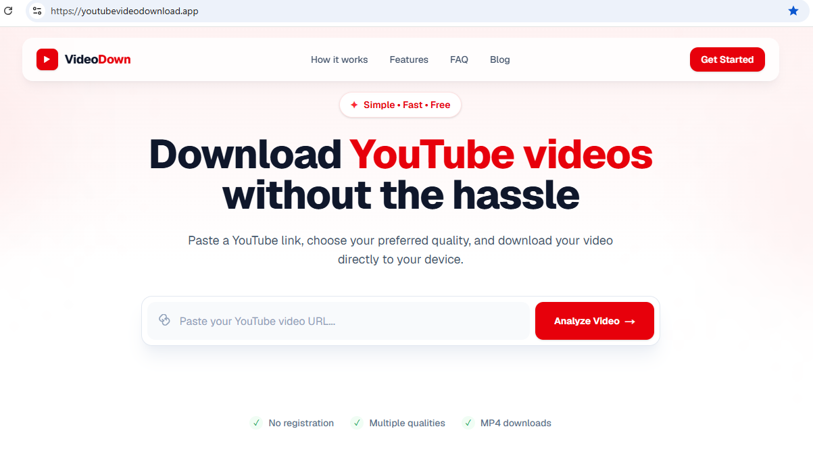
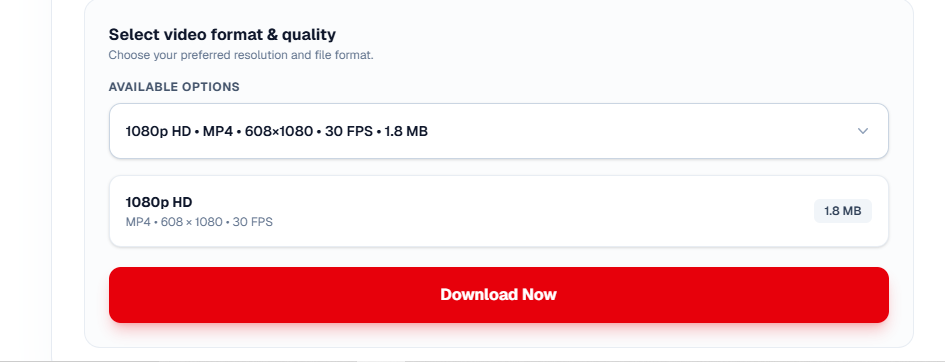

# YouTube Video Downloader

A full-stack web application for retrieving video information, selecting available formats and processing download requests through an asynchronous backend workflow.

## Technology Stack

- **Frontend:** Next.js and TypeScript
- **Backend:** FastAPI and Python
- **Background processing:** Celery and Redis
- **Video processing:** yt-dlp and FFmpeg
- **Database:** PostgreSQL
- **Deployment:** Docker and Docker Compose

## Project Highlights

- REST API development with FastAPI
- Asynchronous background task processing
- Queue-based job management using Celery and Redis
- Video information retrieval and format selection
- Backend service integration and downloadable file delivery
- Containerized application deployment

  
- ## Features

- Retrieve video information from a submitted URL.
- View available video formats and resolutions.
- Process download requests using background tasks.
- Track download job status through the API.
- Process video downloads with yt-dlp and FFmpeg.
- Deliver completed download files through the application.
- Use a responsive web interface built with Next.js and TypeScript.
- Run application services using Docker Compose.

This project demonstrates practical experience building and integrating frontend applications, Python APIs, background workers and supporting infrastructure.

## Architecture Overview

The application separates the user interface, API backend, and background processing to handle download requests asynchronously.

- **Frontend — Next.js:** Provides the user interface for submitting requests and viewing results.
- **Backend — FastAPI:** Handles API requests for video information and downloads.
- **Task processing — Celery:** Executes long-running download tasks asynchronously.
- **Message broker — Redis:** Supports communication between the backend and background workers.
- **Video retrieval — yt-dlp:** Retrieves video information and processes supported download requests.
- **Database — PostgreSQL:** Supports persistent application data.
- **Containerization — Docker Compose:** Helps run the application's services in containers.

### Request Workflow

1. The user submits a video URL through the frontend.
2. The backend validates the request and retrieves video information.
3. When a download is requested, the backend dispatches background work through Celery and Redis.
4. A worker processes the download, and the frontend can retrieve the job status and access the resulting file through the API.


## Installation and Local Setup

### Prerequisites

Before running the project, install:

- [Docker Desktop](https://www.docker.com/products/docker-desktop/) or Docker Engine
- [Docker Compose](https://docs.docker.com/compose/)

### 1. Clone the repository

```bash
git clone https://github.com/arshidaliali/youtube-downloader.git
cd youtube-downloader
```

### 2. Configure environment variables

Create the backend environment file from the example:

```bash
cp backend/.env.example backend/.env
```

Open `backend/.env` and replace `CHANGE_ME` in `DATABASE_URL` with the PostgreSQL password you intend to use.

Create a root `.env` file for Docker Compose:

```bash
echo "POSTGRES_PASSWORD=CHANGE_ME" > .env
```

Replace `CHANGE_ME` with the same PostgreSQL password used in `backend/.env`.

**Security:** Never commit real `.env` files or credentials to version control.

### 3. Start the application

Run the application using Docker Compose:

```bash
docker compose -f docker-compose.yml -f docker-compose.prod.yml up --build -d
```

This starts the application services in the background and builds the required Docker images.


### 4. Access the application

- **Frontend:** http://localhost:3000
- **Backend API:** http://localhost:8000
- **API documentation:** http://localhost:8000/docs

### 5. Stop the application

```bash
docker compose -f docker-compose.yml -f docker-compose.prod.yml down
```

This stops and removes the containers while preserving named volumes, including persistent database and download data.


   
## Screenshots

### Homepage


### Video Format Selection


### Download Completed


**Live Demo:** [youtubevideodownload.app](https://youtubevideodownload.app)

**Source Code:** [View this project on GitHub](https://github.com/arshidaliali/youtube-downloader)

